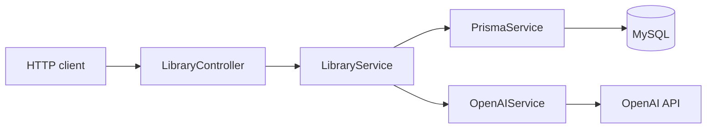
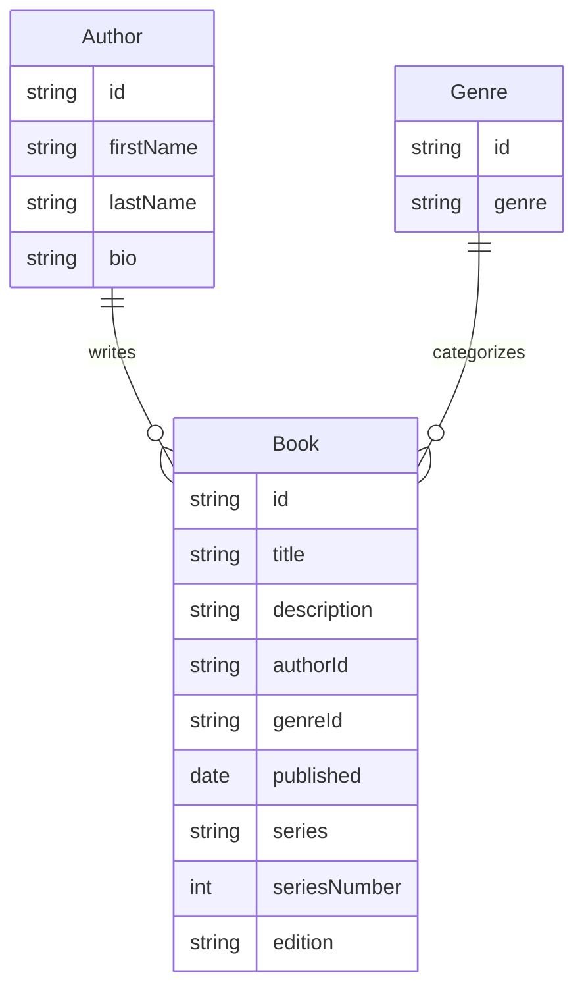

# LibraryService

[](https://github.com/jpamdeth/LibraryService/actions/workflows/ci.yml)

LibraryService is a NestJS REST API for managing a small library catalog of authors, genres, and books. It uses Prisma with MySQL and includes a bring-your-own-key OpenAI recommendation endpoint for suggesting new books from an author's existing catalog.

## Highlights

- NestJS 12 REST API with global validation, throttling, Swagger, and normalized error responses.
- Prisma 7 data layer backed by MySQL.
- CRUD endpoints for authors, genres, and books.
- BYOK OpenAI suggestions using `X-OpenAI-API-Key` or the legacy `apiKey` request body field.
- Docker Compose local environment for API plus MySQL.
- Jest unit and e2e coverage with CI-ready build, lint, test, and audit commands.

## Architecture



## Tech Stack

- Runtime: Node.js 26.13.1 LTS
- Framework: NestJS 12
- ORM: Prisma 7
- Database: MySQL 26.10.0 (Innovation release)
- API docs: Swagger at `/api`
- Tests: Jest, Supertest, ts-jest

## Getting Started

Copy the sample environment file and set values for your machine:

```bash
cp .env.example .env
```

Install dependencies and generate the Prisma client:

```bash
npm ci --ignore-scripts
npm run prisma:generate
```

Run with a local MySQL instance:

```bash
npm run migrate:deploy
npm run start:dev
```

Or run the full local stack with Docker:

```bash
docker compose up --build --wait
```

The API listens on `http://localhost:3000`. Both the API and MySQL are bound to the local machine. Set `LIBRARY_API_PORT` or `LIBRARY_MYSQL_PORT` to use a different host port; if you change the MySQL port, update the host-side `DATABASE_URL` for commands you run outside Docker.

The updated Compose stack uses a fresh, project-scoped database volume. If you have data in the old `nest-mysql-db` volume, back it up and migrate it separately. Do not attach the old MySQL 8 data directory directly to the new server. The local demo connection allows retrieval of the MySQL authentication public key; configure verified TLS instead for a remote server.

## Useful Commands

```bash
npm run build          # Compile TypeScript
npm run lint           # ESLint with auto-fix
npm test               # Unit tests
npm run test:ci        # Unit tests with coverage thresholds
npm run test:e2e       # E2E tests against a database
npm audit              # Security advisory check
docker compose build   # Verify the container build
```

## API Overview

| Method | Path | Description |
| --- | --- | --- |
| GET | `/health` | Service health and version metadata |
| GET | `/library/authors` | List authors |
| POST | `/library/authors` | Create an author |
| GET | `/library/authors/:authorId` | Get one author with books |
| PUT | `/library/authors/:authorId` | Update an author |
| DELETE | `/library/authors/:authorId` | Delete an author |
| GET | `/library/genres` | List genres |
| POST | `/library/genres` | Create a genre |
| GET | `/library/books` | List books |
| POST | `/library/books` | Create a book |
| POST | `/library/suggestions/:authorId` | Suggest books for an existing author |
| POST | `/library/suggestions/:firstName/:lastName` | Create an author and suggest books |

Swagger documentation is available at `http://localhost:3000/api` when the service is running.

## Bring Your Own OpenAI API Key

Recommendation endpoints are designed so each user can provide their own OpenAI API key. The preferred method is the `X-OpenAI-API-Key` header:

```bash
curl -X POST http://localhost:3000/library/suggestions/AUTHOR_ID \
  -H "Content-Type: application/json" \
  -H "X-OpenAI-API-Key: sk-..." \
  -d "{}"
```

For compatibility, the request body can still include `apiKey`, but the header wins when both are present. Keys are not persisted; in-memory OpenAI clients are cached by a SHA-256 hash of the key rather than by the raw secret.

OpenAI request defaults can be tuned through environment variables:

```bash
OPENAI_MODEL=gpt-4o
OPENAI_MAX_TOKENS=1000
OPENAI_TEMPERATURE=0.7
```

## Data Model



## Quality Gates

CI runs dependency installation, Prisma generation, lint, build, unit tests with coverage thresholds, and `npm audit --audit-level=moderate`. A second job builds and starts the production Compose stack, checks the health endpoint and OpenAPI document, and runs the end-to-end suite against disposable MySQL. **Never run the end-to-end suite against a database you want to keep:** it deletes catalog rows during test setup.

TypeScript stays on 6.0 because the current NestJS schematics, `ts-jest`, and TypeScript ESLint releases do not support TypeScript 7. Prisma stays on the latest stable 7.x release while Prisma 8 is a release candidate.
